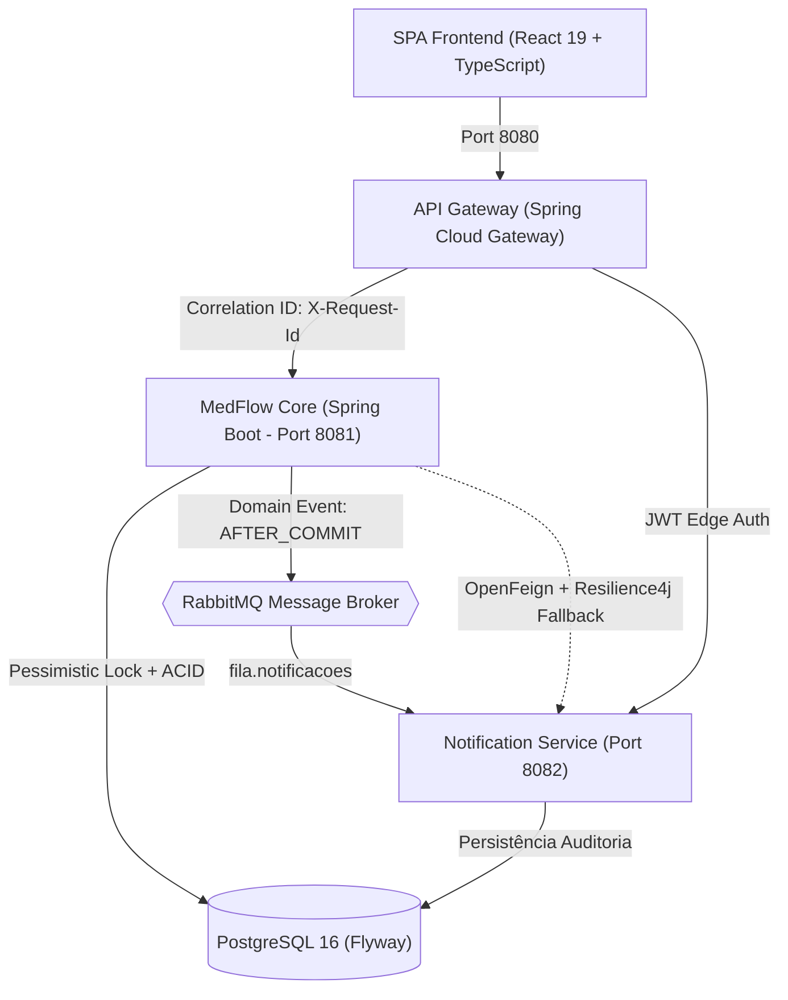

# MedFlow - Sistema de Gestão Hospitalar & Clínica Médica 🏥

[](https://github.com/Samuka310/medflow/actions/workflows/ci.yml)


Bem-vindo ao **MedFlow**, um ecossistema integrado de gestão clínica e hospitalar de alta disponibilidade construído com padrões corporativos de engenharia de software: arquitetura reativa em microsserviços, mensageria orientada a eventos, bloqueios pessimistas contra concorrência, streaming de dados de alto volume, Protocolo Internacional de Triagem de Manchester e esteira de CI/CD completa.

---

## 🏛️ Arquitetura do Ecossistema

O repositório é orquestrado como um projeto multi-módulo Maven (`medflow-aggregator`):



### Módulos do Sistema:
* **`libs/medflow-events`**: Biblioteca comum compartilhada contendo contratos imutáveis de eventos de domínio.
* **`services/api-gateway`**: Edge Gateway reativo na porta 8080 com injeção de `Correlation ID` (`X-Request-Id`), validação de tokens JWT e políticas de CORS.
* **`services/notification-service`**: Microsserviço independente na porta 8082 com consumidor AMQP RabbitMQ idempotente em 2 níveis e persistência de auditoria.
* **`backend/`**: Núcleo clínico e hospitalar na porta 8081 com regras de negócio, agendamento concorrente seguro, prontuário, triagem e faturamento.
* **`frontend/`**: Single Page Application em React 19, TypeScript, Tailwind CSS, TanStack Query e Sonner, com suporte aos 6 perfis clínicos (RBAC).

---

## 🧪 Qualidade de Software, Testes & JaCoCo

O projeto possui uma suíte robusta de testes automatizados unitários, de integração, de concorrência multithread e de endpoints WebMvcTest:

* **Total de Testes:** **101 testes automatizados (100% de aprovação)**
* **Cobertura de Código (JaCoCo):** **70.26% de cobertura de instruções**
* **Esteira de CI/CD (GitHub Actions):** `.github/workflows/ci.yml` executando compilação do reactor, testes com JaCoCo e verificação de build do frontend a cada push.

### Como rodar a suíte de testes e gerar o relatório JaCoCo:
```bash
# Na raiz do repositório:
./mvnw clean test jacoco:report

# O relatório HTML interativo será gerado em:
# backend/target/site/jacoco/index.html
```

---

## 🚀 Como Executar o Sistema Completo via Docker

**Pré-requisito:** [Docker Desktop](https://www.docker.com/products/docker-desktop) instalado e rodando.

Abra o terminal na raiz do projeto e execute:
```bash
docker compose up -d --build
```

Em cerca de 30 a 60 segundos, todos os contêineres estarão saudáveis:
* **Frontend SPA:** [http://localhost:5173](http://localhost:5173)
* **API Gateway (Edge):** [http://localhost:8080](http://localhost:8080)
* **Swagger UI (Documentação OpenAPI 3.0):** [http://localhost:8080/swagger-ui.html](http://localhost:8080/swagger-ui.html)
* **Painel RabbitMQ:** [http://localhost:15672](http://localhost:15672) (`guest` / `guest`)
* **Métricas Prometheus:** [http://localhost:9090](http://localhost:9090)
* **Painel Grafana:** [http://localhost:3000](http://localhost:3000) (`admin` / `admin`)

---

## 👥 Credenciais de Acesso Rápido para Demonstração (Seed Automático)

Ao inicializar, o `DataInitializer` pré-carrega automaticamente todas as especialidades e contas de teste:

| Papel / Perfil | E-mail de Acesso | Senha Padrão | Funcionalidades Principais |
| :--- | :--- | :--- | :--- |
| **Administrador** | `admin@medflow.com` | `admin123` | Dashboard gerencial, auditoria, cadastro de funcionários e importação CSV. |
| **Médico** | `medico@medflow.com` | `medico123` | Fila de atendimento por Manchester, evolução clínica, receitas e atestados em PDF. |
| **Recepção** | `recepcao@medflow.com` | `recepcao123` | Agendamento presencial, check-in, confirmação e reagendamento de consultas. |
| **Triagem** | `triagem@medflow.com` | `triagem123` | Aferição de sinais vitais e classificação de gravidade Manchester por cores. |
| **Faturamento** | `faturamento@medflow.com` | `faturamento123` | Liquidação de pagamentos, conciliação financeira e streaming de CSV. |
| **Paciente** | `paciente@medflow.com` | `paciente123` | Agendamento online de consultas, histórico clínico e download de prescrições. |

---

## 🛠️ Desenvolvimento Local

### Backend (Multi-Module Reactor):
```bash
# Compilar e validar todos os módulos:
./mvnw clean test

# Rodar o backend localmente no perfil dev:
cd backend
../mvnw spring-boot:run "-Dspring-boot.run.profiles=dev"
```

### Frontend (React 19 + TypeScript):
```bash
cd frontend
npm install
npm run dev
# Para verificar a compilação de produção e tipagem TypeScript:
npm run build
```

---

## 🛑 Como Parar o Ambiente
```bash
docker compose down
# Ou para resetar os volumes e banco de dados:
docker compose down -v
```

---

## 📄 Documentação Técnica e Decisões de Arquitetura
Consulte a pasta [`docs/`](./docs):
* [`docs/CURRICULO_PROJECT_DESCRIPTION.md`](./docs/CURRICULO_PROJECT_DESCRIPTION.md) — Destaques para currículo, LinkedIn e guia de entrevistas técnicas.
* [`docs/API.md`](./docs/API.md) — Especificação detalhada de endpoints, RFC 7807 e fluxos clínicos.
* [`docs/ARCHITECTURE.md`](./docs/ARCHITECTURE.md) — Diagramas C4, microsserviços e comunicação inter-serviços.
* [`docs/DESIGN_PATTERNS.md`](./docs/DESIGN_PATTERNS.md) — Guia de Padrões GoF aplicados (Strategy, Template Method, Factory, Builder).
* [`docs/decisions/`](./docs/decisions/) — 8 Architecture Decision Records (ADRs).
