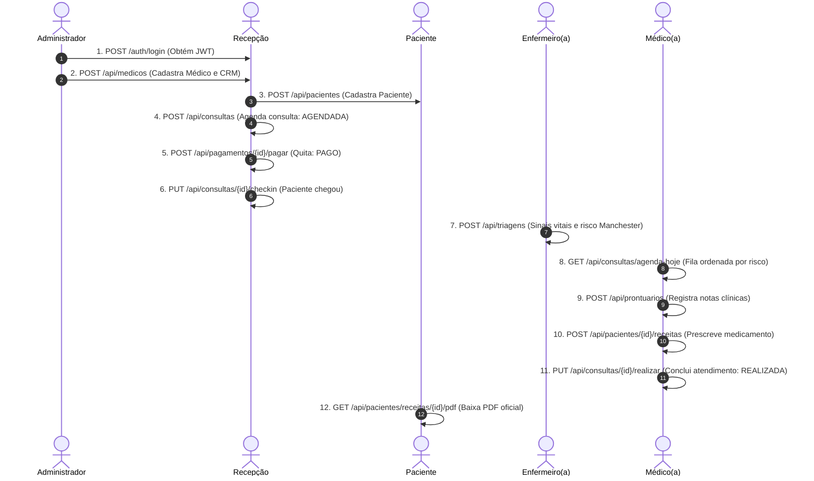

# Documentação Técnica da API REST - MedFlow

O **MedFlow** expõe uma API RESTful corporativa para gestão de clínicas médicas, agendamentos, triagem de urgência (Protocolo de Manchester), faturamento e geração de documentos clínicos (PDFs e CSVs).

---

## 1. Visão Geral e Acesso à Documentação Interativa

A API suporta documentação viva com interface Swagger UI e especificação OpenAPI 3.0:

| Recurso | URL Gateway (Porta 8080) | URL Core Direto (Porta 8081) |
|---|---|---|
| **Swagger UI** | `http://localhost:8080/swagger-ui.html` | `http://localhost:8081/swagger-ui.html` |
| **OpenAPI Spec (JSON)** | `http://localhost:8080/v3/api-docs` | `http://localhost:8081/v3/api-docs` |
| **Postman Collection** | [`docs/postman/MedFlow.postman_collection.json`](file:///c:/Users/Pax%20Primavera/Desktop/MedFlow/medflow/docs/postman/MedFlow.postman_collection.json) |
| **Postman Environment** | [`docs/postman/MedFlow.postman_environment.json`](file:///c:/Users/Pax%20Primavera/Desktop/MedFlow/medflow/docs/postman/MedFlow.postman_environment.json) |

### Como Utilizar no Swagger UI
1. Realize uma requisição de login em `POST /auth/login` (ex.: `admin` / `admin`).
2. Copie o valor de `token` retornado no corpo JSON.
3. No topo direito do Swagger UI, clique no botão **Authorize** (ícone de cadeado).
4. Cole o token no campo de texto (sem a palavra `Bearer`) e clique em **Authorize**. Todas as requisições subsequentes enviarão automaticamente o cabeçalho `Authorization: Bearer <token>`.

### Como Utilizar no Postman
1. Abra o Postman e clique em **Import**.
2. Selecione os arquivos `MedFlow.postman_collection.json` e `MedFlow.postman_environment.json` presentes na pasta `docs/postman/`.
3. Selecione o ambiente **MedFlow - Local Environment**.
4. Ao executar a requisição `01 - Autenticação > Login (Admin)`, o script de teste armazena automaticamente o token JWT na variável `{{token}}`, autenticando toda a coleção.

---

## 2. Autenticação e Autorização

- **Esquema**: `Bearer <JWT_TOKEN>` no cabeçalho HTTP `Authorization`.
- **Validade padrão**: 24 horas (configurável via `jwt.expiration`).
- **Roles disponíveis**:
  - `ADMIN`: Acesso completo ao sistema, auditoria, configurações e cadastro de colaboradores.
  - `MEDICO`: Agenda própria, atendimento clínico, emissão de receitas, atestados e prontuários.
  - `RECEPCIONISTA`: Cadastro de pacientes, agendamento de consultas, check-in e confirmações.
  - `TRIAGEM`: Avaliação e registro de sinais vitais e prioridade de risco (Manchester).
  - `FATURAMENTO`: Gestão de pagamentos, estornos e relatórios financeiros.
  - `PACIENTE`: Agendamento de próprias consultas, visualização do próprio histórico clínico e download de receitas/atestados.

---

## 3. Matriz de Endpoints da API

### 3.1. Autenticação (`/auth`)

| Método | Caminho | Descrição | Roles Permitidas |
|---|---|---|---|
| `POST` | `/auth/login` | Autentica usuário e emite token JWT | Pública |
| `POST` | `/auth/register` | Cria novo usuário padrão (PACIENTE) | Pública |

### 3.2. Administração (`/admin`)

| Método | Caminho | Descrição | Roles Permitidas |
|---|---|---|---|
| `POST` | `/admin/funcionarios` | Cadastra funcionário e vincula a usuário | `ADMIN` |

### 3.3. Especialidades Médicas (`/api/especialidades`)

| Método | Caminho | Descrição | Roles Permitidas |
|---|---|---|---|
| `GET` | `/api/especialidades` | Lista todas as especialidades | Qualquer autenticado |
| `POST` | `/api/especialidades` | Cadastra nova especialidade | `ADMIN` |
| `GET` | `/api/especialidades/{id}` | Busca especialidade por ID | Qualquer autenticado |
| `DELETE` | `/api/especialidades/{id}` | Remove especialidade médica | `ADMIN` |

### 3.4. Médicos (`/api/medicos`)

| Método | Caminho | Descrição | Roles Permitidas |
|---|---|---|---|
| `GET` | `/api/medicos` | Lista médicos (filtro opcional por especialidade) | Qualquer autenticado |
| `POST` | `/api/medicos` | Cadastra médico | `ADMIN` |
| `GET` | `/api/medicos/{id}` | Busca médico por ID | Qualquer autenticado |
| `DELETE` | `/api/medicos/{id}` | Remove médico | `ADMIN` |
| `POST` | `/api/medicos/importar-csv` | Importação em lote via streaming CSV | `ADMIN` |

### 3.5. Pacientes (`/api/pacientes`)

| Método | Caminho | Descrição | Roles Permitidas |
|---|---|---|---|
| `GET` | `/api/pacientes` | Lista todos os pacientes | `RECEPCIONISTA`, `TRIAGEM`, `MEDICO`, `ADMIN` |
| `POST` | `/api/pacientes` | Cadastra novo paciente | `RECEPCIONISTA`, `ADMIN`, `PACIENTE` |
| `GET` | `/api/pacientes/{id}/resumo` | Dados cadastrais do paciente | `RECEPCIONISTA`, `TRIAGEM`, `MEDICO`, `ADMIN`, `PACIENTE` (próprio) |
| `GET` | `/api/pacientes/{id}/clinico` | Dados clínicos confidenciais | `MEDICO`, `ADMIN`, `PACIENTE` (próprio) |
| `DELETE` | `/api/pacientes/{id}` | Remove registro de paciente | `ADMIN` |
| `POST` | `/api/pacientes/importar-csv` | Importação em lote via streaming CSV | `RECEPCIONISTA`, `ADMIN` |
| `POST` | `/api/pacientes/{id}/receitas` | Prescreve receita médica | `MEDICO` |
| `POST` | `/api/pacientes/{id}/atestados` | Emite atestado médico | `MEDICO` |
| `GET` | `/api/pacientes/receitas/{id}/pdf` | Download de receita médica em PDF | `PACIENTE`, `MEDICO`, `ADMIN` |
| `GET` | `/api/pacientes/atestados/{id}/pdf`| Download de atestado médico em PDF | `PACIENTE`, `MEDICO`, `ADMIN` |

### 3.6. Consultas (`/api/consultas`)

| Método | Caminho | Descrição | Roles Permitidas |
|---|---|---|---|
| `POST` | `/api/consultas` | Agenda nova consulta (gera pagamento PENDENTE) | `RECEPCIONISTA`, `ADMIN` ou próprio paciente |
| `PUT` | `/api/consultas/{id}/remarcar` | Altera data/hora da consulta | `RECEPCIONISTA`, `ADMIN` ou próprio paciente |
| `GET` | `/api/consultas` | Lista todas as consultas | `RECEPCIONISTA`, `ADMIN` |
| `GET` | `/api/consultas/hoje` | Agenda geral do dia na recepção | `RECEPCIONISTA`, `ADMIN` |
| `GET` | `/api/consultas/agenda-hoje`| Agenda do médico (ordenada por Manchester e hora) | `MEDICO`, `ADMIN` |
| `PUT` | `/api/consultas/{id}/confirmar`| Confirma agendamento | `RECEPCIONISTA`, `ADMIN` ou próprio paciente |
| `PUT` | `/api/consultas/{id}/checkin` | Registra chegada presencial | `RECEPCIONISTA`, `ADMIN` |
| `PUT` | `/api/consultas/{id}/realizar` | Marca consulta como realizada (requer PAGO) | `MEDICO`, `ADMIN` |
| `PUT` | `/api/consultas/{id}/cancelar` | Cancela consulta (aplica política GoF de estorno) | `RECEPCIONISTA`, `ADMIN` ou próprio paciente |
| `GET` | `/api/consultas/relatorio-csv` | Exporta relatório em streaming CSV | `RECEPCIONISTA`, `ADMIN` |
| `GET` | `/api/consultas/{id}/notificacoes` | Histórico via Feign ao `notification-service` | `RECEPCIONISTA`, `ADMIN` ou próprio paciente |

### 3.7. Triagem Clínica (`/api/triagens`)

| Método | Caminho | Descrição | Roles Permitidas |
|---|---|---|---|
| `POST` | `/api/triagens` | Registra sinais vitais e prioridade Manchester | `TRIAGEM`, `MEDICO`, `ADMIN` |
| `GET` | `/api/triagens/consulta/{consultaId}` | Consulta triagem vinculada à consulta | `RECEPCIONISTA`, `TRIAGEM`, `MEDICO`, `ADMIN` |

### 3.8. Prontuários & Exames (`/api/prontuarios`, `/api/exames`)

| Método | Caminho | Descrição | Roles Permitidas |
|---|---|---|---|
| `POST` | `/api/prontuarios` | Salva notas de atendimento clínico | `MEDICO`, `ADMIN` |
| `GET` | `/api/prontuarios/me` | Histórico do paciente autenticado | `PACIENTE` |
| `GET` | `/api/prontuarios/{id}` | Detalhes do prontuário por ID | `MEDICO`, `ADMIN`, `PACIENTE` (próprio) |
| `POST` | `/api/exames` | Solicita/registra exame no prontuário | `MEDICO`, `ADMIN` |
| `GET` | `/api/exames/prontuario/{prontuarioId}` | Lista exames do prontuário | `MEDICO`, `ADMIN`, `PACIENTE` (próprio) |

### 3.9. Pagamentos & Faturamento (`/api/pagamentos`, `/api/faturamento`)

| Método | Caminho | Descrição | Roles Permitidas |
|---|---|---|---|
| `GET` | `/api/pagamentos/{id}` | Detalhes do pagamento | `FATURAMENTO`, `RECEPCIONISTA`, `ADMIN` ou paciente |
| `POST` | `/api/pagamentos/{id}/pagar` | Quita pagamento (status PAGO) | `FATURAMENTO`, `RECEPCIONISTA`, `ADMIN` |
| `POST` | `/api/pagamentos/{id}/estornar`| Estorna pagamento para PENDENTE | `FATURAMENTO`, `ADMIN` |
| `GET` | `/api/faturamento/relatorio` | Métricas financeiras e faturamento | `FATURAMENTO`, `ADMIN` |
| `GET` | `/api/faturamento/relatorio-csv`| Exportação de pagamentos em streaming CSV | `FATURAMENTO`, `ADMIN` |

---

## 4. Exemplos de Requisições e Respostas

### 4.1. Autenticação: `POST /auth/login`

**Requisição:**
```http
POST /auth/login HTTP/1.1
Host: localhost:8080
Content-Type: application/json

{
  "username": "admin",
  "password": "admin"
}
```

**Resposta de Sucesso (HTTP 200 OK):**
```json
{
  "token": "eyJhbGciOiJIUzI1NiJ9.eyJzdWIiOiJhZG1pbiIsImlhdCI6MTY5NjAwMDAwMCwiZXhwIjoxNjk2MDg2NDAwfQ.xyz...",
  "username": "admin",
  "role": "ADMIN"
}
```

---

### 4.2. Agendamento: `POST /api/consultas`

**Requisição:**
```http
POST /api/consultas HTTP/1.1
Host: localhost:8080
Authorization: Bearer <TOKEN>
Content-Type: application/json

{
  "pacienteId": "a1b2c3d4-e5f6-7890-abcd-ef1234567890",
  "medicoId": "b2c3d4e5-f6a7-8901-bcde-fa2345678901",
  "dataHora": "2026-11-20T14:30:00"
}
```

**Resposta de Sucesso (HTTP 201 Created):**
```json
{
  "id": "c3d4e5f6-a7b8-9012-cdef-ab3456789012",
  "pacienteId": "a1b2c3d4-e5f6-7890-abcd-ef1234567890",
  "medicoId": "b2c3d4e5-f6a7-8901-bcde-fa2345678901",
  "dataHora": "2026-11-20T14:30:00",
  "status": "AGENDADA"
}
```

---

### 4.3. Respostas de Erro no Padrão RFC 7807 (`ProblemDetail`)

Em conformidade com a especificação RFC 7807 e o `GlobalExceptionHandler` do MedFlow:

#### Exemplo 1: Conflito de Horário de Agendamento (HTTP 409 Conflict)
```json
{
  "type": "https://api.medflow.com/erros/conflito-agenda",
  "title": "Conflito de Agenda",
  "status": 409,
  "detail": "Médico já possui consulta agendada ou em andamento neste horário.",
  "instance": "/api/consultas",
  "timestamp": "2026-10-14T17:00:00.123Z"
}
```

#### Exemplo 2: Regra de Negócio Violada (HTTP 422 Unprocessable Entity)
```json
{
  "type": "https://api.medflow.com/erros/regra-de-negocio",
  "title": "Regra de Negócio Violada",
  "status": 422,
  "detail": "Não é possível realizar consulta com pagamento PENDENTE.",
  "instance": "/api/consultas/c3d4e5f6-a7b8-9012-cdef-ab3456789012/realizar",
  "timestamp": "2026-10-14T17:05:00.456Z"
}
```

#### Exemplo 3: Recurso Não Encontrado (HTTP 404 Not Found)
```json
{
  "type": "https://api.medflow.com/erros/recurso-nao-encontrado",
  "title": "Recurso Não Encontrado",
  "status": 404,
  "detail": "Consulta com ID 00000000-0000-0000-0000-000000000000 não encontrada.",
  "instance": "/api/consultas/00000000-0000-0000-0000-000000000000",
  "timestamp": "2026-10-14T17:10:00.789Z"
}
```

#### Exemplo 4: Erro de Validação de Campos (HTTP 400 Bad Request)
```json
{
  "type": "about:blank",
  "title": "Erro de Validação",
  "status": 400,
  "detail": "Um ou mais campos contêm valores inválidos.",
  "instance": "/api/pacientes",
  "erros": [
    { "campo": "cpf", "mensagem": "CPF inválido ou mal formatado." },
    { "campo": "nome", "mensagem": "O nome não pode estar em branco." }
  ]
}
```

---

## 5. Fluxo Típico de Uso em Sequência


