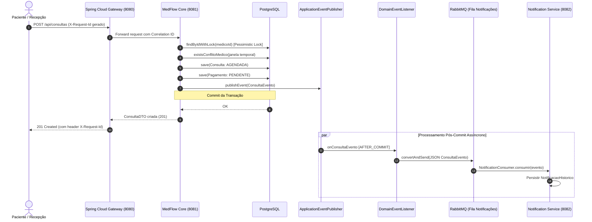

# Arquitetura do Sistema MedFlow

O **MedFlow** é um sistema corporativo de gestão de clínicas médicas e agendamento de consultas, projetado com arquitetura distribuída de microsserviços modernos com **Spring Cloud** e mensageria assíncrona **RabbitMQ**.

---

## 1. Visão Geral da Arquitetura

O sistema é construído sobre o ecossistema Spring Boot moderno (Java 21) e Spring Cloud 2023.0.3 (Leyton), aplicando os seguintes princípios arquiteturais:

- **Clean Architecture & Separation of Concerns**: Separação estrita entre camadas de Controladores REST, Serviços de Negócio, Repositórios de Acesso a Dados e Adaptadores de Segurança/Mensageria.
- **Domain-Driven Design (DDD) Tático**: Máquina de estados explícita nos enums de domínio (`ConsultaStatus`, `PagamentoStatus`), encapsulamento de invariantes de negócio e Value Objects.
- **Transacionalidade e Eventos Desacoplados**: Operações críticas de escrita utilizam `@Transactional`. A comunicação com mensageria não acopla a transação do banco: eventos de domínio (`ConsultaEvento`) são publicados no Spring `ApplicationEventPublisher` e capturados pelo `DomainEventListener` via `@TransactionalEventListener(phase = TransactionPhase.AFTER_COMMIT)`.
- **API RFC 7807 (`ProblemDetail`)**: Respostas de erro padronizadas globalmente pelo `GlobalExceptionHandler`.
- **Microservices & API Gateway Pattern**: Ponto único de entrada, roteamento dinâmico, correlação distribuída de requests (`X-Request-Id`) e comunicação síncrona resiliente via Spring Cloud OpenFeign com Circuit Breaker Resilience4j.

---

## 2. Arquitetura de Microsserviços e Topologia Distribuída (Fase 7)

```mermaid
graph TD
    Client["Navegador / React 19 Frontend<br/>(Porta 5173 / Vercel)"]
    
    subgraph Edge ["Edge Layer"]
        Gateway["Spring Cloud API Gateway<br/>(Porta 8080)<br/>• CorrelationIdFilter (X-Request-Id)<br/>• JwtAuthGlobalFilter<br/>• Centralized CORS"]
    end

    subgraph Microservices ["Malha de Microsserviços"]
        Core["MedFlow Core / Backend<br/>(Porta 8081)<br/>• Agendamento & Prontuários<br/>• Feign Client + Resilience4j<br/>• PostgreSQL & Flyway"]
        Notif["Notification Service<br/>(Porta 8082)<br/>• Consumo de Fila RabbitMQ<br/>• Histórico de Notificações<br/>• API REST Paginada"]
    end

    subgraph MessagingDB ["Infraestrutura de Dados & Mensageria"]
        RabbitMQ[("RabbitMQ Cluster<br/>Exchange: medflow.exchange<br/>Fila: fila.notificacoes")]
        Postgres[("PostgreSQL 16<br/>Database: medflow")]
    end

    subgraph Observability ["Observabilidade & Métricas"]
        Prometheus["Prometheus Server<br/>(Porta 9090)"]
        Grafana["Grafana Dashboards<br/>(Porta 3000)"]
    end

    Client -->|HTTP / JSON| Gateway
    Gateway -->|/api/notificacoes/**| Notif
    Gateway -->|/api/**| Core

    Core -->|AFTER_COMMIT ConsultaEvento| RabbitMQ
    RabbitMQ -->|Consume Event| Notif
    Core -.->|OpenFeign (Sync Fallback Resilience4j)| Notif
    
    Core -->|JDBC / Flyway| Postgres
    
    Prometheus -->|Scrape /actuator/prometheus| Gateway
    Prometheus -->|Scrape /actuator/prometheus| Core
    Prometheus -->|Scrape /actuator/prometheus| Notif
    Grafana --> Prometheus
```

### 2.1. Componentes da Arquitetura Distribuída

1. **`medflow-aggregator` (POM Raiz)**: Orquestrador Maven que compila e executa os testes de todos os módulos (`medflow-events`, `notification-service`, `api-gateway`, `medflow-backend`).
2. **`libs/medflow-events`**: Biblioteca comum contendo o contrato imutável e serializável em JSON do evento de domínio `ConsultaEvento`.
3. **`services/api-gateway` (Spring Cloud Gateway)**:
   - Roteamento transparente de `/api/notificacoes/**` para `notification-service:8082` e demais rotas `/api/**` para `medflow-core:8081`.
   - `CorrelationIdFilter`: Gera ou propaga `X-Request-Id` em cada requisição HTTP, garantindo rastreabilidade distribuída de ponta a ponta.
   - `JwtAuthGlobalFilter`: Filtro de borda que valida a integridade do token JWT antes de encaminhar tráfego aos serviços internos.
   - CORS centralizado eliminando conflitos de cabeçalhos nas chamadas do frontend.
4. **`services/notification-service`**:
   - Microsserviço Spring Boot dedicado com listener RabbitMQ (`NotificationConsumer`), gravação auditável do histórico de disparos em banco (`NotificacaoHistorico`) e API paginada (`GET /api/notificacoes`).
5. **Comunicação Inter-serviços com Resiliência (OpenFeign + Resilience4j)**:
   - O `ConsultaController` no `medflow-core` expõe `GET /api/consultas/{id}/notificacoes`, consumindo `notification-service` via `@FeignClient(name = "notification-service", fallback = NotificationClientFallback.class)`.
   - Caso o serviço de notificações esteja indisponível ou sofra lentidão, o Circuit Breaker do Resilience4j intercepta a falha e aciona o fallback imediatamente, devolvendo uma resposta de contingência sem quebrar a experiência do usuário.

---

## 3. Concorrência e Integridade de Agendamento (Fase 4)

O agendamento e a remarcação de consultas são operações que exigem rigor extremo contra *race conditions* e sobreposição de horários.

### Estratégia Defensiva em 3 Níveis

```
[ Requisição Concorrente 1 ] ──┐
                               ├─► [ Lock Pessimista: Medico (SELECT FOR UPDATE) ]
[ Requisição Concorrente 2 ] ──┘         │
                                         ▼
                               [ Validação Temporal de Janela (duracaoMinutos) ]
                                         │
                                         ▼
                               [ Salvar Consulta (Commit ou Rollback) ]
                                         │
                                         ▼
                               [ Índice Único Parcial no PostgreSQL ]
                                 (uk_medico_data_hora_ativa WHERE status != 'CANCELADA')
```

1. **Serialização via Lock Pessimista**:
   - `medicoRepository.findByIdWithLock(medicoId)` aplica `@Lock(LockModeType.PESSIMISTIC_WRITE)`.
   - Quando múltiplas threads tentam agendar o mesmo médico ao mesmo tempo, a primeira adquire o bloqueio da linha do médico. A segunda thread aguarda a conclusão da primeira transação, prevenindo leituras fantasmas.

2. **Janela Temporal Dinâmica (`ConsultaProperties`)**:
   - Propriedade configurável `medflow.consulta.duracao-minutos` (padrão: 60 minutos).
   - Valida conflitos de horário com `existsConflitoMedico` e `existsConflitoPaciente`:
     `inicio = dataHora - (duracao - 1)`
     `fim = dataHora + (duracao - 1)`
   - Consultas com status `CANCELADA` são ignoradas automaticamente, permitindo que horários cancelados sejam reutilizados por outros pacientes.

3. **Garantia de Integridade no Banco (Flyway V9)**:
   - Índice parcial no PostgreSQL:
     ```sql
     CREATE UNIQUE INDEX uk_medico_data_hora_ativa 
     ON consulta (medico_id, data_hora) 
     WHERE (status != 'CANCELADA');
     ```
   - Em caso de colisão simultânea na borda de banco de dados, `DataIntegrityViolationException` é convertida para `ConflitoAgendaException` (HTTP 409).

4. **Verificação Automatizada**:
   - A classe de teste `ConsultaConcurrencyTest` executa 10 threads simultâneas via `ExecutorService` e `CountDownLatch` disputando o mesmo horário para o mesmo médico.
   - Resultado verificado: **exatamente 1 thread obtém sucesso** e **9 threads recebem `ConflitoAgendaException`**.

---

## 4. Idempotência no Consumo de Mensagens (RabbitMQ)

Para garantir que reentregas de mensagens no RabbitMQ não resultem em duplicação de ações ou envio de múltiplos emails:

1. Todo evento carrega um identificador exclusivo `UUID eventoId` no contrato `ConsultaEvento`.
2. O `NotificacaoListener` implementa estratégia de deduplicação em 2 níveis:
   - **Cache L1 (Em Memória)**: `Set<UUID>` thread-safe (`ConcurrentHashMap.newKeySet()`) para verificação instantânea.
   - **Camada L2 (Banco de Dados)**: Tabela `evento_processado` persistida via JPA, garantindo resiliência entre reinicializações e múltiplas réplicas da aplicação.

---

## 5. Diagrama de Fluxo de Agendamento Distribuído


