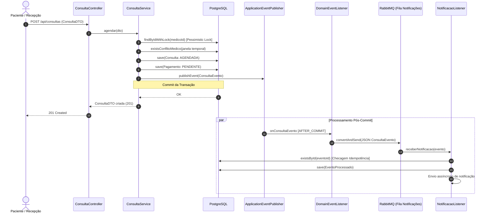

# Arquitetura do Sistema MedFlow

O **MedFlow** é um sistema corporativo de gestão de clínicas médicas e agendamento de consultas, projetado com arquitetura em camadas e evolução orientada a microsserviços e mensageria assíncrona.

---

## 1. Visão Geral da Arquitetura

O sistema é construído sobre o ecossistema Spring Boot moderno (Java 21), aplicando os seguintes princípios arquiteturais:

- **Clean Architecture & Separation of Concerns**: Separação estrita entre camadas de Controladores REST, Serviços de Negócio, Repositórios de Acesso a Dados e Adaptadores de Segurança/Mensageria.
- **Domain-Driven Design (DDD) Tático**: Máquina de estados explícita nos enums de domínio (`ConsultaStatus`, `PagamentoStatus`), encapsulamento de invariantes de negócio e Value Objects.
- **Transacionalidade e Eventos Desacoplados**: Operações críticas de escrita utilizam `@Transactional`. A comunicação com mensageria não acopla a transação do banco: eventos de domínio (`ConsultaEvento`) são publicados no Spring `ApplicationEventPublisher` e capturados pelo `DomainEventListener` via `@TransactionalEventListener(phase = TransactionPhase.AFTER_COMMIT)`.
- **API RFC 7807 (`ProblemDetail`)**: Respostas de erro padronizadas globalmente pelo `GlobalExceptionHandler`.

---

## 2. Concorrência e Integridade de Agendamento (Fase 4)

O agendamento e a remarcação de consultas são operações que exigem rigor extremo contra *race conditions* e sobreposição de horários.

### Estratégia Defensiva em 3 Níveis

```
[ Requisição Concorrente 1 ] ──┐
                               ├─► [ Lock Pessimista: Medico (SELECT FOR UPDATE) ]
[ Requisição Concorrente 2 ] ──┘         │
                                         ▼
                               [ Validação Temporal de Janela (duracaoMinutos) ]
                                         │
                                         ▼
                               [ Salvar Consulta (Commit ou Rollback) ]
                                         │
                                         ▼
                               [ Índice Único Parcial no PostgreSQL ]
                                 (uk_medico_data_hora_ativa WHERE status != 'CANCELADA')
```

1. **Serialização via Lock Pessimista**:
   - `medicoRepository.findByIdWithLock(medicoId)` aplica `@Lock(LockModeType.PESSIMISTIC_WRITE)`.
   - Quando múltiplas threads tentam agendar o mesmo médico ao mesmo tempo, a primeira adquire o bloqueio da linha do médico. A segunda thread aguarda a conclusão da primeira transação, prevenindo leituras fantasmas.

2. **Janela Temporal Dinâmica (`ConsultaProperties`)**:
   - Propriedade configurável `medflow.consulta.duracao-minutos` (padrão: 60 minutos).
   - Valida conflitos de horário com `existsConflitoMedico` e `existsConflitoPaciente`:
     `inicio = dataHora - (duracao - 1)`
     `fim = dataHora + (duracao - 1)`
   - Consultas com status `CANCELADA` são ignoradas automaticamente, permitindo que horários cancelados sejam reutilizados por outros pacientes.

3. **Garantia de Integridade no Banco (Flyway V9)**:
   - Índice parcial no PostgreSQL:
     ```sql
     CREATE UNIQUE INDEX uk_medico_data_hora_ativa 
     ON consulta (medico_id, data_hora) 
     WHERE (status != 'CANCELADA');
     ```
   - Em caso de colisão simultânea na borda de banco de dados, `DataIntegrityViolationException` é convertida para `ConflitoAgendaException` (HTTP 409).

4. **Verificação Automatizada**:
   - A classe de teste `ConsultaConcurrencyTest` executa 10 threads simultâneas via `ExecutorService` e `CountDownLatch` disputando o mesmo horário para o mesmo médico.
   - Resultado verificado: **exatamente 1 thread obtém sucesso** e **9 threads recebem `ConflitoAgendaException`**.

---

## 3. Idempotência no Consumo de Mensagens (RabbitMQ)

Para garantir que reentregas de mensagens no RabbitMQ não resultem em duplicação de ações ou envio de múltiplos emails:

1. Todo evento carrega um identificador exclusivo `UUID eventoId` no contrato `ConsultaEvento`.
2. O `NotificacaoListener` implementa estratégia de deduplicação em 2 níveis:
   - **Cache L1 (Em Memória)**: `Set<UUID>` thread-safe (`ConcurrentHashMap.newKeySet()`) para verificação instantânea.
   - **Camada L2 (Banco de Dados)**: Tabela `evento_processado` persistida via JPA, garantindo resiliência entre reinicializações e múltiplas réplicas da aplicação.

---

## 4. Diagrama de Fluxo de Agendamento


