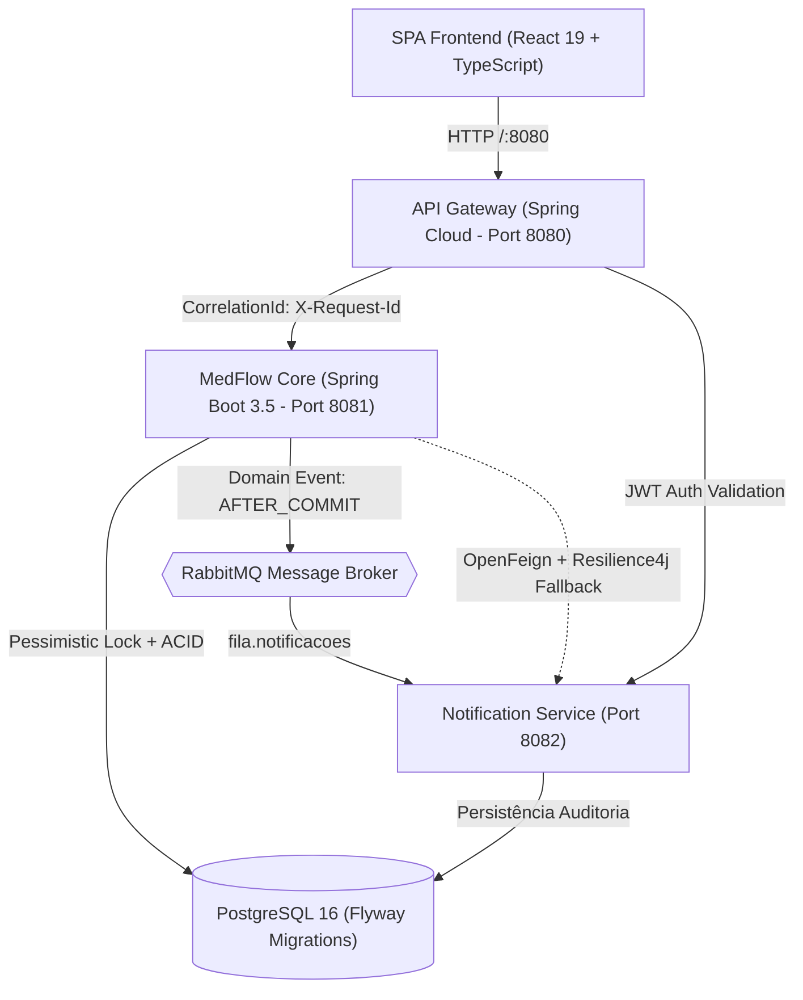

# MedFlow - Descrição para Portfólio e Currículo de Engenheiro de Software Sênior

> **Projeto**: MedFlow — Sistema Integrado de Gestão Hospitalar e Clínica com Arquitetura Reativa em Microsserviços  
> **Perfil / Cargo Simulado**: Senior Fullstack Software Engineer / Java Backend Tech Lead  
> **Repositório**: [github.com/paxprimavera/medflow](https://github.com/paxprimavera/medflow)  
> **Linguagens & Tecnologias**: Java 21, Spring Boot 3.5, Spring Cloud Gateway, OpenFeign, Resilience4j, RabbitMQ, PostgreSQL, Flyway, Docker, Kubernetes, React 19, TypeScript, Tailwind CSS, TanStack Query.

---

## 1. Resumo Executivo do Projeto

O **MedFlow** é uma plataforma clínica e hospitalar moderna de alta disponibilidade projetada para suportar fluxos críticos de saúde, desde a admissão e triagem de urgência até o faturamento e a auditoria médica. O projeto foi arquitetado sob os mais rigorosos padrões da engenharia de software corporativa, implementando microsserviços orientados a eventos, tratamento de concorrência com bloqueios pessimistas, streaming de dados de alto volume e conformidade com o Protocolo Internacional de Triagem de Manchester.

---

## 2. Pontos-Chave para Currículo e LinkedIn (Bullet Points)

### Em Português (Pronto para CV / LinkedIn):
* **Arquitetura em Microsserviços & Edge Gateway**: Projetei e implementei a transição de um monólito inicial para uma arquitetura distribuída multi-módulo Maven (`medflow-aggregator`), composta por Edge Gateway (`Spring Cloud Gateway`) na porta 8080 com injeção de `Correlation ID` (`X-Request-Id`) e validação JWT, Core Hospitalar (`Spring Boot 3.5`), e microsserviço assíncrono de notificações (`Spring AMQP` + `RabbitMQ`).
* **Resiliência e Comunicação Inter-serviços**: Integrei comunicação declarativa síncrona via `Spring Cloud OpenFeign` equipada com fallback defensivo (`Resilience4j Circuit Breaker`) para garantir degradação graciosa da aplicação em caso de indisponibilidade da malha de mensageria.
* **Concorrência e Integridade de Agendamentos**: Solucionei *race conditions* de duplo agendamento simultâneo através de bloqueio pessimista a nível de banco de dados (`PESSIMISTIC_WRITE`) combinado com índice único parcial PostgreSQL (`uk_medico_data_hora_ativa`), validado por suíte de testes de concorrência multithread (`ExecutorService`).
* **Mensageria Orientada a Eventos & Idempotência**: Desacoplei a camada de negócio utilizando *Domain Events* do Spring (`@TransactionalEventListener(phase = AFTER_COMMIT)`) e criei consumo idempotente em 2 níveis (Cache em memória + Tabela de eventos processados no PostgreSQL) para tolerância a falhas na entrega at-least-once do RabbitMQ.
* **Processamento de Alto Volume & I/O em Streaming**: Desenvolvi importação de dados clínicos em lote via streaming (`BufferedReader` com chunks de memória constantes) com relatório linha a linha de falhas de integridade, e exportação de faturamento via `StreamingResponseBody` com BOM UTF-8 para integração com Microsoft Excel.
* **Padrões de Projeto (GoF) & Clean Code**: Apliquei Strategy Pattern para políticas de cancelamento e estorno graduais, Template Method para importadores de entidades médicas, Factory Method para canais de notificação (E-mail, SMS, WhatsApp) e Builder Pattern com invariantes de período para filtros dinâmicos de auditoria.
* **Padronização RFC 7807 & Documentação Viva**: Estabeleci hierarquia de exceções de domínio seladas (`sealed interfaces`) mapeadas para o padrão IETF RFC 7807 (`ProblemDetail`), documentação OpenAPI 3.0 em todos os 12 controllers e suite de testes funcionais automatizados no Postman.
* **Frontend SPA Completo (React 19 + TypeScript)**: Construí interface web moderna com Tailwind CSS, TanStack Query, Sonner e controle de acesso baseado em papéis (RBAC) com 6 personas ativas: Administrador, Médico, Recepcionista, Enfermeiro de Triagem, Analista de Faturamento e Paciente.

### In English (Ready for International Resume / LinkedIn):
* **Distributed Microservices & Edge Gateway**: Engineered a distributed multi-module Maven system featuring an edge `Spring Cloud Gateway` (JWT validation & `X-Request-Id` correlation propagation), asynchronous notification microservice via RabbitMQ, and resilient inter-service communication with `OpenFeign` and `Resilience4j` Circuit Breakers.
* **High-Concurrency Booking & Database Locks**: Mitigated double-booking race conditions by coupling JPA pessimistic locking (`PESSIMISTIC_WRITE`) with a PostgreSQL partial unique index, backed by stress and concurrency test suites running on multi-threaded thread pools.
* **Event-Driven Architecture & Idempotent Consumer**: Decoupled domain transactions using transactional Spring application events, publishing immutable contracts (`medflow-events`) to RabbitMQ with a 2-tier idempotent deduplication layer (in-memory LRU cache + persisted event table).
* **Streaming I/O & Document Processing**: Built memory-efficient CSV batch imports using streaming `BufferedReader` with line-by-line syntax diagnosis, streaming CSV export using `StreamingResponseBody`, and dynamic PDF clinical document generation via OpenPDF.
* **Software Design Patterns & Domain-Driven Refactoring**: Implemented Strategy, Template Method, Factory Method, and Builder patterns, enforcing SOLID principles and replacing magic strings with type-safe state machine enums.
* **Modern React 19 Frontend**: Developed a complete TypeScript SPA with role-based routing (6 clinical personas), Manchester triage urgency ranking, live toast feedback, and full reactive state management via TanStack Query.

---

## 3. Arquitetura e Decisões Técnicas de Destaque



### Arquitetura de Pastas e Componentes
* `libs/medflow-events`: Contratos e DTOs imutáveis compartilhados entre microsserviços.
* `services/api-gateway`: Ponto único de entrada, roteamento reativo, injeção de Correlation ID e políticas de CORS.
* `services/notification-service`: Consumidor de mensagens assíncronas com auditoria e envio multicanal.
* `backend/`: Núcleo hospitalar com controle de prontuário, Manchester, agendamento e faturamento.
* `frontend/`: Single Page Application em React 19, TypeScript, Vite, Tailwind CSS e TanStack Query.
* `docs/`: 8 Architecture Decision Records (ADRs), Coleção Postman, Swagger OpenAPI e guia de Design Patterns.

---

## 4. Guia de Perguntas de Entrevista Técnica

### P1: Como você tratou o problema de agendamento simultâneo de consultas para o mesmo médico no mesmo horário?
> **Resposta Sênior**: "Adotamos uma estratégia de defesa em profundidade em 3 camadas:
> 1. No nível da aplicação, aplicamos `@Lock(LockModeType.PESSIMISTIC_WRITE)` na consulta do médico antes de verificar a disponibilidade na agenda.
> 2. No nível do banco de dados relacional, criamos um índice único parcial no PostgreSQL: `CREATE UNIQUE INDEX uk_medico_data_hora_ativa ON consulta (medico_id, data_hora) WHERE (status != 'CANCELADA')`. Isso garante integridade absoluta mesmo que duas instâncias concorrentes da aplicação tentem agendar simultaneamente.
> 3. No nível do Spring MVC, capturamos a `DataIntegrityViolationException` no `@RestControllerAdvice` e a convertemos para o padrão RFC 7807 com status HTTP 409 (Conflict). Tudo isso é testado com um teste multithread automatizado usando `ExecutorService` e `CountDownLatch`."

### P2: Como você garante que mensagens assíncronas no RabbitMQ não sejam processadas duas vezes?
> **Resposta Sênior**: "Como mensagerias baseadas em AMQP garantem entrega no modelo *at-least-once*, implementamos o padrão Idempotent Consumer com duas barreiras:
> - Barreira 1 (Rápida / Memória): Um cache em memória com TTL que rejeita instantaneamente mensagens recebidas nos últimos minutos com o mesmo UUID de evento.
> - Barreira 2 (Persistente / ACID): Uma tabela `evento_processado (id UUID PRIMARY KEY, tipo VARCHAR, processado_em TIMESTAMP)`. Antes de processar a notificação, tentamos registrar o ID do evento em uma transação atômica. Se houver colisão de chave primária, a mensagem é descartada de forma segura sem reprocessamento indevido."

### P3: Por que utilizar `StreamingResponseBody` na exportação de faturamento em vez de carregar a lista completa na memória?
> **Resposta Sênior**: "Em um ambiente hospitalar real, um relatório de faturamento pode conter centenas de milhares de linhas. Alocar toda essa lista em uma `List<Pagamento>` e serializá-la como uma grande `String` provocaria picos massivos de memória Heap, sobrecarregando o Garbage Collector e podendo causar *OutOfMemoryError*. Com o `StreamingResponseBody`, os dados são lidos em lotes com cursores ou streams e gravados diretamente no `OutputStream` da resposta HTTP à medida que são gerados, garantindo consumo de memória estritamente constante e baixa latência inicial."

---

## 5. Como Executar e Demonstrar o Projeto

### Backend & Microsserviços
```bash
# Na raiz do projeto:
mvn clean test
docker-compose up -d
```

### Frontend
```bash
cd frontend
npm install
npm run dev
```

### Contas de Acesso Rápido para Demonstração:
* **Administrador**: `admin@medflow.com` / `admin123`
* **Médico**: `medico@medflow.com` / `medico123`
* **Recepcionista**: `recepcao@medflow.com` / `recepcao123`
* **Triagem Manchester**: `triagem@medflow.com` / `triagem123`
* **Faturamento**: `faturamento@medflow.com` / `faturamento123`
* **Paciente**: `paciente@medflow.com` / `paciente123`
